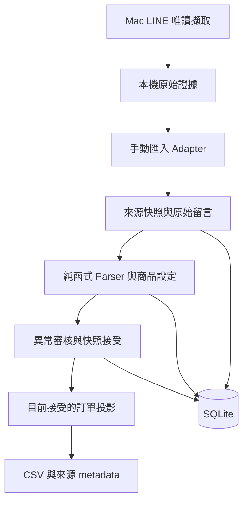

# 開發 PLAN

日期：2026-11-05。S00 契約與開發骨架已開始；實際進度見 root PLAN 與 SLICES 完成紀錄。
目前 phase、授權範圍與 anti-goals 統一由 [root PLAN.md](../PLAN.md) 記錄；本檔保存產品設計。
背景與外部依據見 [ASSESSMENT](ASSESSMENT.md)，逐片工作見 [SLICES](SLICES.md)。

## 1. 產品目標與邊界

首輪擷取驗證在 Mac LINE 上，由單一操作者開啟記事本。
先支援單篇商品記事本、該篇的多 SKU、單機 SQLite 與 CLI。
擷取先產生本機原始證據，再逐筆核對並整理成手動匯入快照。

MVP 工作流程：設定商品 → 匯入留言快照 → 檢視解析與異常 → 完成人工核對 →
選定目前快照 → 輸出買家明細、商品統計與來源資訊。

第一版不做多使用者伺服器、網站後台、金流、物流、跨平台收單、任意自然語言理解、
未經確認的跨群買家合併或無人值守同步。

## 2. 架構與相依方向



- `domain` 定義資料物件與狀態，不依賴 Windows、CLI 或 SQLite。
- Adapter 只提供來源資料與能力／完整性證據，不替 parser 決定訂單。
- Parser 為確定性的純函式，同輸入與同設定得到同結果；不存檔、不查 LINE。
- Reconciliation 決定接受哪份快照及哪些解析結果，不猜來源沒有提供的 ID。
- Storage 管理版本、約束與交易；Exporter 僅讀取已選定的資料版本。
- CLI 串接流程。Mac 擷取由指令按需啟動，手動匯入可在不同平台獨立執行。

建議使用標準函式庫的 `dataclasses`、`argparse`、`sqlite3`、`csv`，
YAML 設定只加入必要的解析相依。先不引入 ORM、Web framework 或外部 AI 服務。
Python 3.12 是首個測試基線；其他版本要跑過測試才列為支援。

## 3. 建議檔案結構

以下是預定結構，不代表檔案均已建立。

```text
line-note-order-sync/
├── README.md
├── pyproject.toml
├── .gitignore
├── docs/
│   ├── ASSESSMENT.md
│   ├── PLAN.md
│   ├── SLICES.md
│   ├── PRD.md
│   ├── DATA_CONTRACT.md
│   └── CAPTURE_FEASIBILITY.md
├── src/notesync/
│   ├── cli.py
│   ├── domain/models.py
│   ├── adapters/                 # 手動匯入、Mac 擷取與原始證據
│   ├── parser/{normalize,order_parser}.py
│   ├── reconcile/order_reconciler.py
│   ├── storage/sqlite.py
│   └── exporters/csv_exporter.py
├── config/products.example.yaml
└── tests/
    ├── fixtures/                 # 合成資料，可提交
    ├── test_parser.py
    ├── test_import.py
    ├── test_reconcile.py
    └── test_export.py
```

`data/`、`exports/`、`local-evidence/` 是預定的 Git 忽略目錄；實際留言與截圖不進 fixtures。

## 4. 最小資料模型

表名為設計草案，S00 確認語意，S03 才建立實際 schema。

| 實體 | 必要內容 | 約束 |
| --- | --- | --- |
| Note / ProductConfig | `scope_key`、`source_kind`、`note_key`、SKU／別名、設定內容與雜湊 | 商品代號限該篇；設定保存實際版本內容 |
| CaptureBatch | 原始輸入與雜湊、擷取時間、匯入時間、來源範圍、完整性與證據、adapter 版本 | 不靠標題自動識別記事本；完整性與接受狀態分開 |
| CommentOccurrence | batch、批次內位置、原文、可選 source comment/author ID、顯示暱稱與來源時間 | 無 ID 就保留缺失；同內容可有多筆 |
| ParseRun / ParsedItem | parser 版本、設定雜湊、comment occurrence、SKU、數量、全文判讀狀態、理由 | 每個結果可回查原文與版本 |
| ReviewDecision | 對象、原結果、新結果、理由、時間、操作者 | 追加紀錄；不改寫原文或自動移植到新解析版本 |
| AcceptedSnapshot / OrderItem | 每篇選定 batch + parse run、接受時間、內部 buyer key、來源 occurrence | 每篇最多一份目前版本；交易內切換 |

MVP 缺少原生作者 ID 時，以同社群暱稱分組買家，接受同名／改名風險；
不要求逐則人工映射。保存 occurrence 與人工拆分／合併紀錄，不用暱稱判定來源編輯事件。
S08 再實作人工登錄的 NoteRegistry（來源、note key、OPEN／LOCKED、最後成功版本）；
已結團的 LOCKED 記事本不得由新擷取覆寫已交付叫貨版本，商品與快照依記事本隔離。

原始輸入至少保存一份逐位元可驗證的內容；可先存入 SQLite，避免第一版就引入外部
檔案與 DB 的一致性問題。若日後改為檔案儲存，另定義失敗回復與備份方式。
時間儲存含時區，內部可統一 UTC；畫面與報表標示 Asia/Taipei。

### 重匯與重新解析

1. 用來源範圍、`note_key`、原始輸入雜湊與匯入格式版本辨識同一輸入快照；
   同 bytes 屬於不同記事本時仍是不同資料。
2. 相同快照、parser 版本與商品設定重跑不建立重複有效訂單；
   是否記錄再次觀察可另存，不能改變總數。
3. 只改換行等排版可能形成新輸入；不猜它是新留言，而是另份待選快照，故仍不累加。
4. parser 或設定變更可建立新 parse run，保留舊結果，待重新接受。
5. 缺少原生 ID 時，跨快照只提供候選差異供人工核對，不能推定刪除或修改。

### 匯入格式

先定義單一 UTF-8 結構化 JSON 快照格式，包含來源 metadata 與 comments 陣列；
作者 ID、留言 ID、來源時間允許缺失，缺失不能填成推測值。
另支援一種由實際人工複製樣本確認的 TXT 格式。
作者與留言分段不可靠的 TXT 應保留原文並回報不支援，讓操作者整理成結構化格式。
P0 不承諾辨識所有 LINE 複製格式。

## 5. 里程碑與通過條件

| 里程碑 | 範圍 | 完成條件 | 不通過時 |
| --- | --- | --- | --- |
| M0：定義基線 | S00 | PRD、資料契約、合成驗收樣本與可執行的開發環境 | 先解決契約矛盾，不進入資料寫入 |
| M1：擷取決策 | S01 | 限定版本與來源的實驗，產出 `FEASIBLE`、`NOT_FEASIBLE` 或 `INCONCLUSIVE` 及證據 | 後兩者停止自動擷取投入，沿手動路徑繼續 |
| M2：手動 MVP | S02–S05 | 匯入、解析、交易儲存、重匯、審核、接受、CSV 全流程通過 | 未解異常不產生正式叫貨報表 |
| M3：單篇試用 | S06 | Windows 乾淨環境可執行，單篇結果逐筆對人工答案；備份恢復可行 | 記錄不支援案例並修正所屬 slice |
| M4：條件式自動化 | S07–S09 | 僅對已證明能力逐項啟用；Sheets 可單獨走手動接受後匯出路徑 | 缺能力則維持人工核對，不補猜測邏輯 |

M1 必須早做，但它不否定手動核心的交付價值。
上述判定是本專案的驗收狀態，沒有引入額外的外部核准流程。

## 6. 順序與工時假設

```text
S00 ──→ S01 擷取實驗 ──→ 符合能力條件時才進 S07／S08
  └──→ S02 → S03 → S04 → S05 → S06：手動 MVP 與試用
                            └──→ S09：接受後的 Sheets 匯出
```

這表示依賴分支，沒有要求建立多 agent 或多條開發分支。
單人預設先 S00、S01，再順序完成 S02–S06。

在「一種來源、一種 TXT 格式、嚴格喊單文法、CLI」假設下，
S00–S06 初估約 **7–13 個工程日**，包含 S01 的 1–2 日限時實驗。
這是工程估算，不是交期承諾；等待本人登入、準備來源、人工核對與修正未知格式另計。
若 1–2 日內仍無法證明 UIA 完整性，就做結論並繼續手動 MVP，不延長成完整自動化工程。
第一輪實測後應重估 P1，不能把 P0 工時當作完整點點替代品成本。

## 7. 驗證策略

- Parser 用表格案例測試有效、無效、部分命中、全形、多行、未知 SKU、超量及改單文字。
- Storage／reconciliation 用暫存 SQLite 做真正交易測試，包含失敗回滾、重開 DB、
  同批重匯、相同文字多 occurrence、同名買家、規則重跑、舊檔晚匯入及部分新快照。
- Export 用固定人工答案比對明細與商品總量，並測公式字首、中文編碼與來源可回查。
- UIA 用本機實驗證據，不以 mocked UIA 測試宣稱 LINE 可用；完整性與 ID 穩定性分別判定。
- 試用用單篇人工基準驗收；成功範圍只限該來源類型、版本與條件。
- S01 的 30 筆案例只是初步擷取實驗；S08 前另驗證至少 100 筆或實際尖峰量、
  延遲載入、重疊與擷取中新增留言，每批仍須提出完整性與一致時間窗證據。
- S01/S06 比較原人工流程與匯入、核對耗時及異常比例，不以技術通過宣稱營運效益。

## 8. 長期維護與公開策略

S00 建立套件邊界、合成 fixtures 與最小 CI 設定；有測試後納入 Windows 核心測試。
S03 起保存 schema 版本，遷移前備份，S06 驗證還原流程。
相依套件採明確版本範圍與可重建的安裝方式；選定工具後記錄，先不增加多套管理器。

GitHub repo 目前為公開，本 PR 僅含規劃文件。實際試用資料維持本機保存。
發布程式版本前確認 LICENSE、第三方相依授權、Git 歷史與敏感資料，
再補 CONTRIBUTING 與支援範圍。授權選擇不阻擋目前規劃，但未選定前不宣稱已發布開源版。
本機測試、遠端 CI、實機擷取、試用與公開發布各自記錄結果，不能互相替代。

## 9. 當前下一步

執行 S00：把首個測試來源、商品設定、手動輸入格式及正反驗收樣本寫成契約。
現在不啟動定期同步、不存取 LINE 登入資訊、不設定外部服務，也不把本計畫視為發布授權。
